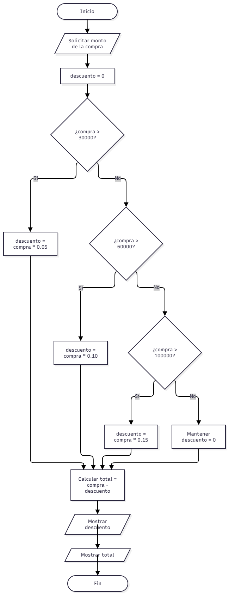

# Análisis y mejora de programas con flujo condicional

Una tienda en línea desea calcular el descuento que recibe un cliente dependiendo del monto de su compra.

Las reglas establecidas por la tienda son:

- Compras menores de ₡30 000: no tienen descuento.
- Compras desde ₡30 000 hasta menos de ₡60 000: reciben un 5 %.
- Compras desde ₡60 000 hasta menos de ₡100 000: reciben un 10 %.
- Compras de ₡100 000 o más: reciben un 15 %.

El programa proporcionado es el siguiente:

```python
compra = float(input("Monto de la compra: "))

descuento = 0

if compra > 30000:
    descuento = compra * 0.05

elif compra > 60000:
    descuento = compra * 0.10

elif compra > 100000:
    descuento = compra * 0.15

total = compra - descuento

print("Descuento:", descuento)
print("Total:", total)
```

---

## Parte 1: Analizar el programa

### ¿Qué datos recibe el programa?

El programa recibe el monto de la compra ingresado por el usuario. Este dato se solicita mediante `input()` y se convierte a un número decimal utilizando `float()`, para poder realizar los cálculos del descuento y del total.

### ¿Qué variables utiliza?

El programa utiliza las variables `compra`, `descuento` y `total`.

- `compra`: almacena el monto ingresado por el usuario.
- `descuento`: guarda el monto que se rebajará y comienza con un valor de 0.
- `total`: almacena el monto final después de restar el descuento a la compra.

### ¿Qué decisión o decisiones toma el programa?

El programa toma la decisión de determinar cuánto descuento aplicar dependiendo del monto de la compra.

Intenta seleccionar entre un descuento de 0 %, 5 %, 10 % o 15 % mediante una estructura condicional `if` y `elif`.

### ¿Qué condiciones se evalúan?

El programa evalúa las siguientes condiciones, en este orden:

```python
compra > 30000
compra > 60000
compra > 100000
```

Cada condición intenta determinar cuál porcentaje de descuento debe aplicarse según el monto de la compra.

### ¿Qué sucede cuando una condición es verdadera?

Cuando una condición es verdadera, el programa ejecuta la instrucción correspondiente y calcula el descuento asociado.

Como se utiliza una estructura `if` y `elif`, después de encontrar la primera condición verdadera no se evalúan las condiciones posteriores.

### ¿Qué sucede cuando ninguna condición se cumple?

Cuando ninguna condición se cumple, la variable `descuento` conserva su valor inicial de 0.

Por lo tanto, no se aplica ningún descuento y el valor de `total` queda igual al monto de la compra.

### ¿El orden de las condiciones afecta el resultado?

Sí, el orden de las condiciones afecta el resultado.

Como la condición:

```python
compra > 30000
```

se evalúa primero, cualquier compra superior a ₡30 000 entra en esa condición y recibe un 5 % de descuento.

Debido a que se utiliza `if` y `elif`, las condiciones posteriores ya no se evalúan.

Por esta razón, los descuentos del 10 % y 15 % no se aplican correctamente.

---

## Parte 2: Analizar el flujo condicional

El siguiente diagrama representa el funcionamiento actual del programa proporcionado.



### ¿El diagrama representa realmente las reglas establecidas por la tienda?

El diagrama representa correctamente el funcionamiento del código proporcionado, pero no representa correctamente las reglas establecidas por la tienda.

Esto se debe a que la condición `compra > 30000` se evalúa primero, por lo que cualquier compra superior a ₡30 000 recibe un 5 % y las condiciones posteriores no llegan a evaluarse.

Además, el uso del operador `>` provoca problemas con los valores límite. Por ejemplo, una compra exactamente de ₡30 000 no cumple la condición `compra > 30000`, aunque las reglas indican que desde ₡30 000 debe aplicarse un descuento del 5 %.

---

## Parte 3: Comprobar la funcionalidad del flujo condicional

Se analizaron los valores indicados en la práctica para comparar el resultado del programa con las reglas establecidas por la tienda.

| Entrada | Resultado esperado | Resultado del programa | Estado |
|---:|---|---|---|
| ₡20 000 | Descuento ₡0, total ₡20 000 | Descuento ₡0, total ₡20 000 | Correcto |
| ₡30 000 | Descuento ₡1 500, total ₡28 500 | Descuento ₡0, total ₡30 000 | Incorrecto |
| ₡45 000 | Descuento ₡2 250, total ₡42 750 | Descuento ₡2 250, total ₡42 750 | Correcto |
| ₡60 000 | Descuento ₡6 000, total ₡54 000 | Descuento ₡3 000, total ₡57 000 | Incorrecto |
| ₡80 000 | Descuento ₡8 000, total ₡72 000 | Descuento ₡4 000, total ₡76 000 | Incorrecto |
| ₡100 000 | Descuento ₡15 000, total ₡85 000 | Descuento ₡5 000, total ₡95 000 | Incorrecto |
| ₡120 000 | Descuento ₡18 000, total ₡102 000 | Descuento ₡6 000, total ₡114 000 | Incorrecto |

### Análisis de los valores límite

#### ₡30 000

Según las reglas de la tienda, una compra de ₡30 000 debe recibir un descuento del 5 %.

Sin embargo, el programa evalúa:

```text
30000 > 30000 → Falso
```

Por esta razón, no se aplica ningún descuento.

El resultado obtenido es:

- Descuento: ₡0.
- Total: ₡30 000.

El resultado correcto debería ser:

- Descuento: ₡1 500.
- Total: ₡28 500.

El problema en este caso es el uso del operador `>`.

### ₡60 000

Según las reglas, una compra de ₡60 000 debe recibir un descuento del 10 %.

Sin embargo, la primera condición evaluada es:

```text
60000 > 30000 → Verdadero
```

Por lo tanto, el programa aplica inmediatamente el descuento del 5 % y no continúa evaluando los `elif`.

El resultado obtenido es:

- Descuento: ₡3 000.
- Total: ₡57 000.

El resultado correcto debería ser:

- Descuento: ₡6 000.
- Total: ₡54 000.

En este caso, el problema principal está en el orden de las condiciones.

### ₡100 000

Según las reglas, una compra de ₡100 000 debe recibir un descuento del 15 %.

Sin embargo, el programa evalúa primero:

```text
100000 > 30000 → Verdadero
```

Por esta razón, aplica un descuento del 5 % y no continúa con las demás condiciones.

El resultado obtenido es:

- Descuento: ₡5 000.
- Total: ₡95 000.

El resultado correcto debería ser:

- Descuento: ₡15 000.
- Total: ₡85 000.

Nuevamente, el problema principal está en el orden de las condiciones.

### Resultado del análisis

Los valores límite muestran dos problemas importantes en el programa.

Con ₡30 000 no se aplica el 5 % porque se utiliza `>` y no se incluye la igualdad.

En los casos de ₡60 000 y ₡100 000, el programa aplica solamente un 5 % porque primero evalúa `compra > 30000` y, al resultar verdadera, ya no continúa con los `elif` posteriores.

Por lo tanto, el orden de las condiciones y los operadores de comparación provocan resultados incorrectos.