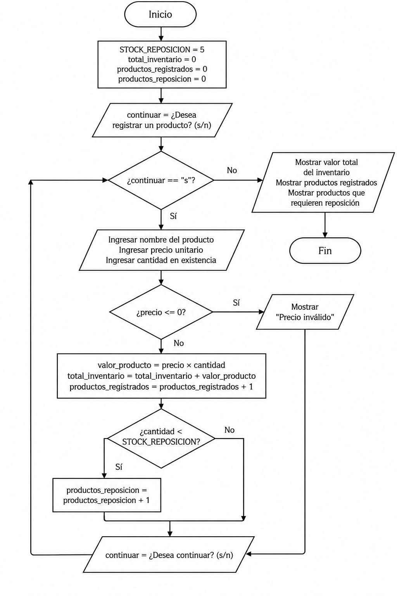

# Inventario de una tienda

Una tienda desea registrar el inventario de sus productos. El sistema debe permitir ingresar productos hasta que el usuario decida terminar.

Las reglas establecidas son:

- El ciclo se ejecuta mientras el usuario ingrese `"s"`.
- Si el precio es menor o igual a cero, se muestra un error y no se registra el producto.
- Si la cantidad es menor a 5, el producto se marca como "requiere reposición".
- Se acumula el valor total del inventario mediante el precio multiplicado por la cantidad.
- Al finalizar, se muestra el valor total del inventario, la cantidad de productos registrados y la cantidad de productos que requieren reposición.

---

## Parte 1: Analizar el problema

### ¿Qué datos debe ingresar el usuario?

El usuario debe ingresar:

- El nombre del producto.
- El precio unitario.
- La cantidad disponible en existencia.
- Si desea continuar registrando productos mediante una respuesta `s` o `n`.

### ¿Qué cálculos debe realizar el programa?

El programa debe calcular el valor de cada producto multiplicando:

```text
precio unitario × cantidad
```

Además, debe acumular estos valores para obtener el valor total del inventario.

### ¿Qué valores permanecen fijos durante la ejecución?

La cantidad mínima utilizada para determinar si un producto requiere reposición permanece fija durante la ejecución.

Se utiliza la constante:

```python
STOCK_REPOSICION = 5
```

También se mantiene como regla que un precio menor o igual a 0 no es válido.

### ¿Qué decisiones debe tomar el programa?

El programa debe decidir:

- Si el usuario desea registrar productos.
- Si el precio ingresado es válido.
- Si el producto debe registrarse.
- Si la cantidad del producto es menor a 5 y requiere reposición.
- Si el usuario desea continuar ingresando productos.

### ¿Qué acciones deben repetirse?

Se debe repetir el proceso de:

1. Solicitar los datos del producto.
2. Validar el precio.
3. Calcular el valor del producto.
4. Comprobar si requiere reposición.
5. Actualizar los contadores y acumuladores.
6. Preguntar si se desea continuar.

### ¿Cuántas veces se repite la acción?

No se sabe de antemano cuántos productos serán ingresados.

El ciclo continúa mientras el usuario indique que desea seguir registrando productos.

Por esta razón, se utiliza un ciclo `while`.

### ¿Qué variable cambia en cada repetición para que el ciclo pueda terminar?

La variable que controla el ciclo es `continuar`.

Inicialmente guarda la respuesta del usuario y después de cada producto puede cambiar a `"n"` para finalizar el ciclo.

### ¿Qué información debe mostrarse al finalizar?

Al finalizar, el programa debe mostrar:

- El valor total del inventario.
- La cantidad de productos registrados.
- La cantidad de productos que requieren reposición.

---

## Parte 2: Diseñar el diagrama de flujo con ciclos

El siguiente diagrama representa el funcionamiento del programa y muestra el ciclo utilizado para registrar productos.



### Tipo de ciclo utilizado

Se utiliza un ciclo `while` porque no se conoce de antemano cuántos productos serán registrados.

El ciclo continúa mientras el usuario indique `"s"` y termina cuando cambia la respuesta a `"n"`.

Dentro del ciclo se ingresan los datos del producto, se valida el precio, se realizan los cálculos y se actualizan los contadores y acumuladores.

---

## Parte 3: Diseñar los casos de prueba

Antes de implementar el programa en Python, se diseñaron casos de prueba para comprobar el funcionamiento del ciclo y de las diferentes decisiones.

Después de implementar el programa, se ejecutaron los mismos casos para comparar los resultados obtenidos con los esperados.

| N.º | Tipo de prueba | Datos de entrada | Condición / iteración que se prueba | Salida esperada | Resultado real | ¿Coincide? |
| --- | --- | --- | --- | --- | --- | --- |
| 1 | Normal (varias iteraciones) | Producto A: ₡1 000, cantidad 10. Producto B: ₡2 000, cantidad 4 | Varias iteraciones y producto con reposición | Total: ₡18 000. Registrados: 2. Reposición: 1 | Total: ₡18 000. Registrados: 2. Reposición: 1 | Sí |
| 2 | Ciclo cero iteraciones | Responder `n` al inicio | El ciclo no se ejecuta | Total: ₡0. Registrados: 0. Reposición: 0 | Total: ₡0. Registrados: 0. Reposición: 0 | Sí |
| 3 | Una sola iteración | Mouse: ₡5 000, cantidad 8, luego `n` | Una única ejecución del ciclo | Total: ₡40 000. Registrados: 1. Reposición: 0 | Total: ₡40 000. Registrados: 1. Reposición: 0 | Sí |
| 4 | Última iteración (límite) | Cable: ₡2 500, cantidad 5, luego `n` | Cantidad exactamente igual al límite | Total: ₡12 500. Registrados: 1. Reposición: 0 | Total: ₡12 500. Registrados: 1. Reposición: 0 | Sí |
| 5 | Rama verdadera dentro del ciclo | Producto: precio ₡0, cantidad 10, luego `n` | Precio inválido | Mostrar "Precio inválido". Total: ₡0. Registrados: 0. Reposición: 0 | Se mostró "Precio inválido". Total: ₡0. Registrados: 0. Reposición: 0 | Sí |

### Análisis de las pruebas

En el primer caso se comprobó que el ciclo puede ejecutarse varias veces y acumular correctamente el valor de diferentes productos.

En el segundo caso se comprobó que el programa puede finalizar sin realizar ninguna iteración cuando el usuario responde `"n"` desde el inicio.

El tercer caso permitió comprobar una única iteración del ciclo.

El cuarto caso comprobó el valor límite de reposición. Como la regla indica que la cantidad debe ser menor a 5, un producto con exactamente 5 unidades no requiere reposición.

El quinto caso comprobó la validación del precio. Cuando el precio es 0, el producto no se registra y no modifica los contadores ni el valor total del inventario.

Todos los resultados obtenidos coincidieron con los resultados esperados.

---

## Parte 4: Implementar la solución en Python

La solución se implementó utilizando variables, una constante, estructuras condicionales, un ciclo `while`, acumuladores y contadores.

El programa desarrollado es:

```python
# Constante para determinar cuándo un producto requiere reposición
STOCK_REPOSICION = 5

# Variables acumuladoras y contadores
total_inventario = 0
productos_registrados = 0
productos_reposicion = 0

# Preguntar si desea comenzar a registrar productos
continuar = input("¿Desea registrar un producto? (s/n): ")

while continuar.lower() == "s":
    print("\n--- Registro de producto ---")

    nombre_producto = input("Nombre del producto: ")
    precio_unitario = float(input("Precio unitario: ₡"))
    cantidad = int(input("Cantidad en existencia: "))

    if precio_unitario <= 0:
        print("Precio inválido. El producto no fue registrado.")

    else:
        valor_producto = precio_unitario * cantidad
        total_inventario = total_inventario + valor_producto
        productos_registrados = productos_registrados + 1

        if cantidad < STOCK_REPOSICION:
            productos_reposicion = productos_reposicion + 1
            print("El producto requiere reposición.")
        else:
            print("El producto no requiere reposición.")

        print("Producto registrado correctamente.")

    continuar = input("\n¿Desea continuar? (s/n): ")

print("\n--- Resumen del inventario ---")
print(f"Valor total del inventario: ₡{total_inventario:,.2f}")
print(f"Productos registrados: {productos_registrados}")
print(f"Productos que requieren reposición: {productos_reposicion}")
```

El código también se encuentra guardado en el archivo:

```text
inventario_tienda.py
```

### Funcionamiento del ciclo

El ciclo:

```python
while continuar.lower() == "s":
```

permite repetir el registro de productos mientras el usuario indique que desea continuar.

Al final de cada repetición se vuelve a solicitar una respuesta. Si el usuario escribe `"n"`, la condición deja de cumplirse y el ciclo termina.

### Acumulador

La variable:

```python
total_inventario
```

funciona como acumulador, ya que aumenta con el valor de cada producto registrado.

### Contadores

Las variables:

```python
productos_registrados
productos_reposicion
```

funcionan como contadores.

`productos_registrados` aumenta cada vez que se registra correctamente un producto.

`productos_reposicion` aumenta cuando la cantidad del producto es menor a 5.

---

## Parte 5: Aplicar convenciones y estilos adecuados

Antes de finalizar el programa se revisaron las convenciones y la claridad del código.

Se utilizaron:

- Nombres de variables descriptivos como `precio_unitario`, `total_inventario` y `productos_registrados`.
- La constante `STOCK_REPOSICION` escrita en mayúsculas.
- Una indentación adecuada dentro del ciclo y de las estructuras condicionales.
- Mensajes claros para indicar si un producto se registró o si el precio fue inválido.
- Una condición de salida alcanzable mediante la variable `continuar`.
- Un acumulador para calcular el valor total del inventario.
- Contadores para registrar la cantidad de productos y los productos que necesitan reposición.

El programa mantiene una estructura sencilla y permite identificar claramente el flujo secuencial, las decisiones y las acciones que se repiten.

---

## Conclusión

El ejercicio permitió utilizar un ciclo `while` para resolver una situación en la que no se conoce de antemano la cantidad de repeticiones necesarias.

Además del ciclo, se utilizaron variables, constantes, estructuras condicionales, acumuladores y contadores.

Los casos de prueba permitieron comprobar diferentes situaciones, incluyendo varias iteraciones, cero iteraciones, una única iteración, un valor límite y un precio inválido.

Después de ejecutar los cinco casos, los resultados obtenidos coincidieron con los resultados esperados, por lo que el programa cumple con las reglas establecidas para el inventario de la tienda.